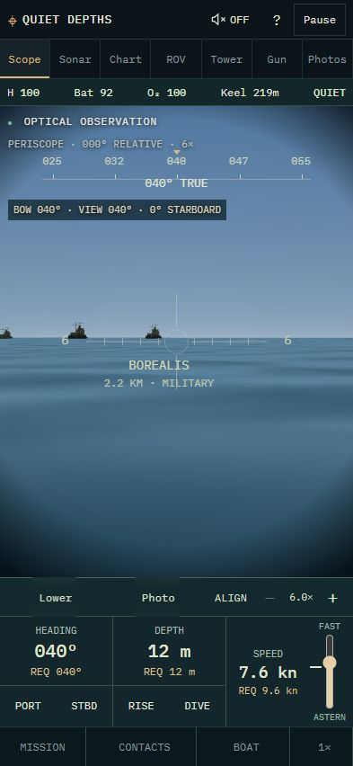

# Quiet Depths

A browser submarine game about incomplete information and calculated exposure. Take a fictional diesel-electric boat on nine randomized mission types in 1972.

[Play Quiet Depths](https://pmarreck.github.io/quiet_depths/). Sound starts OFF. Desktop keyboard/mouse and mobile touch controls are included; WebGL is needed for the ocean views. No account or installation is required.



Choose **Install game** in the briefing for mobile installation. In Safari, use **Share → Add to Home Screen** and enable **Open as Web App**. The installed game works offline after its first complete online load.

## Build and run

Nix is required to build and test the static site. Enable flakes. The pinned toolchain targets x86-64 and ARM64 Linux, including through WSL, and Apple silicon macOS. Any of those builds produces the same browser game.

```sh
./build  # Build the site with Nix and link it at result/
./test   # Verify the game and installed site without changing result/
./run    # Build and preview at http://127.0.0.1:4173
./run --about  # Print the release version, build revision and preview platform
```

The build compiles the Elm mission picker and runs the full Node test suite and JavaScript syntax checks. The installed-site check verifies that the service worker requests every packaged asset and that the briefing and preview command agree with the build record. Preview serves the Nix output directly. Any static web server can serve it. The tracked `dist/` is the snapshot used by the existing staging Site.

The built site's `build-provenance.json` records the release version and, for a clean Git build through `./build` or `./test` with complete `yolo` history, the `rN-abcdef` revision, full commit hash, and primary-branch base. The briefing shows the short `rN` label and includes the full revision in its tooltip. Dirty builds, shallow clones, source exports, and direct `nix build` calls report when a revision is unavailable. GitHub Pages verifies the artifact commit against the workflow checkout before publishing from `yolo`.

The regular test suite checks that refreshing an unchanged list of contacts takes O(n) key reads. To compare this workload against historical measurements, create a local history directory once with `mkdir -p "${XDG_STATE_HOME:-$HOME/.local/state}/performance-history"` and run `./big_o`. Set `PERFORMANCE_HISTORY_URL` to use another existing directory. The profiler reports the first observation for each hardware cohort for review before accepting a baseline.

## Play

Choose reconnaissance, interception, either Seek and Destroy patrol, Sneaky Seamen, passive surveillance, undersea rescue, surface rescue, or wreck survey. **Seek and Destroy: Convoy** requires sinking three military transports. **Seek and Destroy: Sub** can put two enemy submarines in the area. Survive by surfacing at extraction, even if you withdraw without sinking either boat. Submarine kills earn a commendation, and sinking two in one patrol earns a separate commendation. Your service record shows lifetime totals. **Sneaky Seamen** starts at Gate A. Reach Gate B at any depth through a convoy patrol with at least one submarine. An intercepted search ping leaves a bearing on sonar and chart. Repeated pings can mark a broad search area; they do not provide a measured range. The patrol window is 30 simulated minutes. Use 5× and 20× for transit. New contacts and attacks return time to 1×. Progress autosaves in this browser’s local storage.

**Difficulty and realism** in the briefing controls damage advantage, detectability, ping detection, how much depth helps, and how long enemies pursue. You can also choose whether to allow enemy air support, classified satellite photographs, or the ROV. Exact enemy locations and the external orbit view are optional. Turn on the orbit camera there, then press V or choose **Orbit** during the patrol. Drag to circle the boat and use the wheel or +/− to zoom. The patrol continues in the camera. Use its **Pause** control to hold time, and leave with **Exit view** or Esc. Customize keyboard shortcuts or restore their defaults in **Settings**.

Enemy hunters steer and aim from their last detection. A change of course or depth can make their search pass you by, and distant shots have a wider spread. The three acoustic noisemakers can draw a hunter away. The post-patrol debrief shows what exposed the boat, where the enemy searched, and which shell and depth-charge attacks missed.

- **1–7**: periscope, sonar, chart, drone, conning tower, deck gun, photos.
- **P**: raise/lower scope at 15 meters or less. Drag to pan; scroll to zoom.
- **F**: take a periscope photograph. A merchant within five degrees of the reticle also earns reconnaissance mission credit. Separate silhouettes require separate framing.
- **G**: active sonar. Range information also exposes you.
- **R**: silent running, limited to 3 knots.
- **W/S**: increase/decrease requested speed of the vehicle under control, including astern.
- **A/D**: turn requested heading left/right. Actual heading follows with a bounded turn rate.
- **Space/C**: change requested depth toward the surface/deeper. Actual depth follows gradually.
- **Esc**: pause or resume. Physical camera movement, helm orders, sonar pings, weapons, repairs and drone deployment are blocked while paused. Station selection and chart inspection remain available.
- **Drone**: deploy at 280 meters or less and 3 knots or less. Stay within 100 meters in three dimensions; exceeding the radius or exhausting the drone battery loses it for this patrol. A 10% alarm warns you to return. Its camera is fixed dead ahead; the same keyboard and helm controls pilot the drone while its station is selected. Recall before its battery runs out. The submarine keeps its own orders.
- **Periscope**: angle is relative to the submarine, so turning the hull turns the view. Inactive optics are fully blank and cannot rotate or zoom. A stowed/lost drone also has no view.
- **Sonar**: heading-up, with relative contact bearings and a rotating north indicator. True bearings remain available through navigation and the periscope.
- Drag the chart to pan and use the wheel to zoom around the cursor. Click without dragging to order a waypoint. Requested depth stays under your control; Center Boat restores following.

The helm shows white actual ticks and gold requested ticks for heading, depth and speed. Its numeric readouts identify both values. The interface uses 16-pixel body text, 14-pixel controls and 12-pixel secondary metadata, with reflow on smaller displays. Existing patrol saves migrate to the new control fields.

Diesel runs above 14 meters, charging air and battery but making noise. Electric runs submerged and consumes finite battery and oxygen. The boat starts with a 220-meter depth tolerance. Impacts reduce it. Pursuing escorts drop delayed charge patterns. Repairs take time and battery. Acoustic torpedoes may acquire the wrong ship; identified neutrals are protected by the UI, but a seeker can still stray.

## Weather, soundings and sound

New patrols randomize starting position, heading, convoy layout, target name, mission requirements, casualty location and extraction. Random time/weather is the default; you can select dawn, day, dusk or night, plus clear, cloudy, rain or storm conditions. The briefing shows the generated patrol seed. Tap it to copy, type a seed, or choose **New Seed**. During a patrol, select the **Quiet Depths** logo and **Use this setup** to fill in the original seed, mission, starting conditions, and difficulty. Choose **Begin Patrol** to replay from the beginning. Changing weather fronts are optional. The environmental sky clock completes a day in 48 simulated minutes, independently of the patrol's elapsed-time counter. Fronts change every five simulated minutes and blend over 75 seconds. Night and storms reduce optical identification and the distance at which escorts can spot an unlit submarine. Running lights remain visible farther than dark hull silhouettes. Heavy weather masks some near-surface passive sound; deeper water reduces that masking.

**Save slots** in the briefing holds six manual checkpoints on this device, alongside the automatic continue save. Each slot shows the mission, elapsed patrol time, seed, and a submarine portrait when WebGL is available. Saving over a slot asks for confirmation. Loading a slot resumes the patrol at that checkpoint. The photo archive and service record are shared across patrols.

The renderer and simulation share the same wave components and weather parameters. Storms increase wave height, speed, ship motion, rain and occasional periscope wash. Daylight, cloud cover, sun/moon direction, stars, running lights and lightning respond to the environmental state. The seafloor strip shows total water depth and space beneath the submarine's keel, five meters below its pressure-depth reference. Pitch increases the boat’s vertical hull extent. The drone uses its own position and a 0.7-meter collision radius. Shallow clearance is highlighted.

In the ROV or external camera, look up from below to see the animated underside of the waves. In clear daylight, the waves focus moving ribbons of light into the shallows. The renderer uses approximate exponential attenuation, with warmer colors fading first. The illustrative blue band retains about 1% of its surface light at 200 meters in the clear reference case. Clouds weaken the shafts, and the ROV lamp remains usable at depth. For the physical background, see [NOAA on light in the ocean](https://oceanservice.noaa.gov/facts/light_travel.html) and [measurements of wave-focused sunlight](https://opg.optica.org/ao/abstract.cfm?uri=ao-49-6-1041).

Enable Sound for continuous nearby engine/propeller noise, panned relative to the submarine's heading and attenuated by three-dimensional distance. Engine pitch follows vessel kind and speed. Thunder, torpedo detonations and charge explosions are located events with emission times. Their wavefronts are checked against the moving listener, and already-heard events are saved to prevent replay after loading.

Acoustic travel uses approximate constant speeds of 340 m/s in air and 1500 m/s in seawater, following [NOAA's sound reference](https://oceanservice.noaa.gov/facts/sound.html). Surface thunder uses direct three-dimensional air travel. Submerged thunder uses the minimum-time two-segment path through a flat air/water interface, found by a bounded numerical search. Thunder is represented by an effective point 65% of the way up the visible lightning channel. Its gain and low-pass cutoff decrease with listener depth, including while a rumble is already playing. Wavefront timing uses simulated seconds, so time compression also compresses flash-to-thunder delays.

Depth charges have a location, fuse depth and sinking interval. On detonation they emit an underwater pressure front. Nearby damage and sound occur when that front reaches the submarine. The drone can see sinking canisters and expanding underwater blast bubbles. Explosions get quieter and more filtered with distance; their propagation is distinct from air-origin thunder. The audio is procedural, with bounded effect voices and a master compressor.

This is a game approximation: no temperature/salinity profiles, full lightning-channel acoustics, sea-interface wave refraction, multipath echoes or calibrated sound-pressure levels. Unit checks compare the interface-path solver against an independent exhaustive search and verify attenuation, moving-listener arrival, charge timing and save round trips. The browser checks verify rendering and WebAudio scheduling/graph activity; subjective mix quality still needs listening-based playtesting.

Between midnight and 06:00, a quiet watch may hear a crew member snoring. Nearby enemies, pursuit, combat, alarms and silent running interrupt it. With sound on, the boat has occasional mess chatter and clinks after 07:00, noon, and 18:00 on the patrol clock. Original synthesized music plays occasionally from 19:00 to 23:00. Crew reactions and the onboard mix are quieter during silent running or detection. The game bundles eight AI-generated crew recordings, including whispered lines, and plays them offline.

## Rescue, survey and vehicle consequences

Undersea Rescue puts a disabled submarine on the reef shelf. Plot Approach sets a nearby waypoint, rescue depth and 3-knot transit, then stops. If you bring the boat alongside yourself, choose **Start Rescue Here** in Mission to hold your position and match rescue depth. Hold 30–75 meters away, within five meters of the stated rescue depth, and at 0.6 knots or less. Divers leave the bottom hatch, assess the casualty for 22 seconds and transfer a survivor every nine seconds. The awaiting count starts as a question mark, then resolves. After the last transfer, hold another nine seconds for the team’s return. Some casualties have no survivors. The first timed loss falls between 6:25 and 7:55 of patrol time. Later losses are spaced 1:45 to 3:35 apart, depending on the patrol seed. An optional hostile patrol adds pressure.

Surface Rescue needs 30–85 meters of separation, surface depth under one meter, and the same low speed. Rescue launches shuttle survivors aboard. The casualty gradually settles and goes under after roughly fifteen to nineteen patrol minutes, ending further transfers. A detected surfaced boat can draw delayed shellfire from escorts within 2.6 km. Escorts pursue and may ram shallow hulls. Raised periscopes passing under another vessel can be sheared away.

Wreck Survey accepts 45 seconds of close scanning at 0.5–3 knots, within 100 meters horizontally and 32 meters vertically, or three drone photographs from sides at least 55 degrees apart. Aim within 32 degrees of the wreck and stay within 85 meters for photographs. Findings include a ship’s bell, navigation records, ceramics or trade coins. These are mission rewards and flavor, not an inventory economy. The chart marks the reported site and the deployed drone, while hostile positions remain uncertain.

The drone collides with hulls, wrecks and the seabed. Impacts damage its integrity, thrusters, buoyancy and camera; a collision with your own boat can also damage plating. Charge pressure fronts reach the drone independently of their arrival at the submarine. Camera damage cracks the image, mobility damage reduces speed/turning, and buoyancy damage makes depth holding harder. Docking below 3 knots recharges at 0.32 percentage points per second and repairs at a crew-dependent rate. Charging uses boat battery unless diesel supplies power. Lost drones stay lost until a new patrol. Inspection shows fish schools, sharks, a whale and seabed octopuses, plus rescue divers, carried survivors and surface launches.

The motion model uses [speed-dependent control-surface lift](https://www1.grc.nasa.gov/beginners-guide-to-aeronautics/lift-coefficient-2/) and [variable ballast](https://ndsf.whoi.edu/alvin/systems/). The rudder needs speed through the water. Manual port and starboard inputs reverse astern, while the helmsman compensates when given an absolute bearing. Turn rate rises with speed toward a fictional gameplay cap. Requested depth drives gradual ballast changes and dive-plane deflection. The planes pitch the hull and forward motion carries it along the incline. A surface order keeps positive buoyancy through the final approach. Buoyancy moves an all-stop boat; planes add speed-dependent lift, while accumulated floodwater adds weight. Engine, propeller, air/scrubbers, ballast, planes, rudder, sonar, periscope and repair crew have separate condition. Damage control uses battery, pumps water, seals leaks and repairs recoverable systems. Injured crew work more slowly. Inflow above pump capacity fills compartments and can overwhelm buoyancy. Severe shocks can rarely detonate a stored torpedo. A sheared periscope cannot be repaired during a patrol; the conning tower remains available when fully surfaced and blanks as soon as you dive.

The outer hull retains impact damage for the rest of the patrol. Damage Control can reinforce internal bulkheads, seal leaks and pump bilge water. Both hull conditions determine the current depth limit, shown in Boat. On mobile, the watch strip shows ship time, elapsed patrol time and the depth limit. An amber alarm warns of pressure leaks. More than 12% past the limit triggers a louder red alarm and returns time compression to 1× on entry. After 20 consecutive simulated seconds in that band, the chance of implosion rises with excess depth. Rising out of the band resets that exposure.

The detailed boat has a five-blade rotating propeller, shaft, forward/aft planes, stern rudder, deck fittings, masts and a hinged rescue hatch. Propeller RPM follows signed boat speed. Vapor particles and additional acoustic noise depend on a local cavitation number using ambient/hydrostatic pressure, vapor pressure, advance speed and blade rotational speed, following [MIT 2.611 Cavitation Notes](https://www.ocw.mit.edu/courses/2-611-marine-power-and-propulsion-fall-2006/b5483b7eff2776524737db0929227a26_04cavitation.pdf). Blade loading, RPM gearing and bubble appearance are tuned fictional parameters, so this is not a calibrated real-vessel cavitation threshold.

Lightning bolts have branched geometry, a short display hold so time compression does not skip them, and a bearing/range cue for off-screen flashes. Thunder still follows the located emission and moving-listener travel calculation. Low-frequency traffic carries farther underwater than in air in the game’s attenuation model. Sound starts OFF on every page load and requires an explicit click to open the audio device. Audio routing can be checked without playing sound in the browser; subjective mix quality remains a playtesting task.

## Weapons, air support and touch controls

Every patrol carries six acoustic torpedoes. Select a contact in Contacts/Weapons, check its identity and bearing, then launch. The torpedoes leave alternating bow tubes and trail bubbles. Shots against surface ships climb into a shallow, wake-producing run. After the four-second arming run, a torpedo uses its own sonar to steer and adjust depth. If it loses contact, it searches in widening turns until it reacquires or runs out of range. Enemy submarines carry two decoys, each with a 25% chance to divert a shot. Set the maximum run distance for each shot in Contacts. At its limit it shuts down and the ticker reports a missed run. During patrol, the crew reports explosions and possible hull collapses by sound. A cross on the chart marks a probable wreck at an estimated position. A close sighting can confirm it. Sinking vessels settle on the seabed and can be visited. Civilian strikes remain in the post-patrol record, including decoy diversions. The debrief names the vessel and displays a disciplinary stamp alongside the mission outcome.

You can spot incoming and outgoing torpedoes in the 3D views. Look for bubbles underwater, foam near the surface and a pair of small counter-rotating propellers at the tail. Enemy submarines fire toward their last report. If a shot passes that point, it begins a widening search. With sound on, you can hear seeker pings from either side.

On Sonar, select 1.5, 3 or 6 km for the outer ring. The sonar and chart plot vessels only. The top of the sonar plot is your bow. Dashed spokes show bearing without a range fix, and diamonds show estimated positions. Peaks on the hydrophone trace mark bearings around the boat. The trace runs from bow through starboard, stern and port before returning to bow. Active Ping can estimate range and alert nearby hunters.

Fully surface to use the gun station. Drag horizontally and vertically to aim, or select a visually identified target and use AIM AT TARGET. Hold FIRE or J. The 240-round supply is finite, and every fifth round is a tracer. Aim at a ship's waterline to open flooding; repeated hits disable propulsion and sinking continues after firing stops. Aircraft can also be hit. Diving blanks the sight and prevents firing.

Detected military traffic can radio Greybank island. Aircraft prepare for 45–59 simulated seconds, take off from the modeled runway and physically fly to the last report. They search, strafe visible surfaced boats and drop delayed ordnance. Diving and moving quietly breaks visual tracking, but does not erase the last reported position. Aircraft engines attenuate with distance and become muffled below the surface.

On a phone, a fixed helm stays below the scene. Hold Port/Starboard or Rise/Dive to change requested orders; use the vertical speed slider for ahead/astern. Its thumb marks the request and its light tick marks actual speed. Tap a numeric readout for an exact order. Actual and requested heading/depth stay visible as the vehicle responds. Mission, Contacts and Boat open compact sheets; tap outside to close. Boat includes propulsion, silent running, repair, resources and the ROV bay. Sonar has an Active Ping action. Scope, ROV, gun and chart actions sit directly below their scene. Use ALIGN to center the scope or turn the boat to its sight bearing, and +/− for magnification. The surface binoculars reach 12×; the scope reaches 24×. The helm supports simultaneous fingers and cancels held input on release, interruption, pause or rotation. Hardware iPhone/Safari validation remains playtesting work.

On a phone, drag the live ROV feed sideways to turn. Drag up to rise or down to dive. The camera tilts with the climb or dive, and the wide speed slider sets ahead or astern independently.

The ROV cable runs from the submarine’s side hatch to the ROV chassis and moves with the water. Recall follows a deterministic clearance lane to an underwater docking point, including when the submarine is surfaced. Hull collisions remain active. A status strip shows deployment and range outside the ROV station; it flashes if the boat outruns the drone's damage-dependent top speed. Slow to three knots or less for pickup. Both the surfaced indication and gun availability use the same one-meter threshold, independent of individual wave crests.

## Classified reconnaissance and photographs

On Chart, choose Recon Area, then tap the center of a 10 km square and request the pass. You can queue a request while deep, but uplink waits for 15 meters or less. The prototype spends 90–150 seconds retasking/awaiting an overpass, takes two exposures ten seconds apart to estimate velocity, and processes them before transmission. Each stage shows progress. Surface transfer takes 18 seconds; shallow submerged transfer takes `80 + 8 × depth` seconds for a full image. Reception holds below 30 meters and resumes when you rise. The next task is locked for eight minutes after delivery.

Clear daylight can identify surface vessels. Clouds and rain produce partial, uncertain coverage; storms block requests. Night images locate running lights without giving new identities. Submarines, undetected ships under cloud and objects outside the square are not disclosed. Chart fixes retain their capture time, so transmission delay already counts against freshness. A constant-velocity estimate and growing 95% uncertainty ellipse account for velocity error and unobserved maneuvering. These are game probabilities, not a calibrated tracking solution. Unnamed contacts receive stable A1–A9, B1–B9 and subsequent designations; identification preserves the code. Torpedo firing bearings use the observed estimate from the current boat position.

Photos archives actual rendered periscope/ROV exposures and north-up monochrome orbital plates, with capture and receipt timestamps. It preserves up to 24 images within a bounded local-storage budget across patrols and reloads. Old saves gain an empty archive rather than fabricated historical images. Recon images render frozen observations from exposure time, never the later live fleet. Photographic visibility and survey/recon mission credit remain separate requirements.

The classified electronic imaging and underwater image relay are deliberate fictional exceptions to 1972. [NRO's history](https://www.nro.gov/Portals/135/documents/news/press/2021/2021-06-60th%20Anniversary%20Declassification_11162021.pdf) dates near-real-time electronic reconnaissance to KENNEN in 1976; earlier optical systems returned film. [GAO's submarine communications assessment](https://www.gao.gov/assets/psad-79-48a.pdf) describes very low throughput and shallow receiving antennas for VLF. The game's raised/trailing antenna abstraction, depth cutoffs and transfer times are play tuning. They do not imply that real 1972 boats could receive photographs through tens of meters of seawater at these rates.

GitHub Actions runs the complete Nix build and tests before uploading the resulting static output to GitHub Pages. A failing build cannot deploy. Pull requests run the same build without publication.

## Historical design choices

The [USS Blueback National Register nomination](https://heritagedata.prd.state.or.us/historic/index.cfm?do=main.loadFile&load=NR_Noms/08000947.pdf) describes cross-shaped stern surfaces ahead of a five-blade brass propeller. The game uses that arrangement with a smaller helical screw. Its matte gray coating follows the chosen game appearance; it is not a claim that Blueback's brass screw was painted gray.

The compact dark propeller, tapered single-screw hull and sail planes draw on the [Barbel design described by NHHC](https://www.history.navy.mil/research/histories/ship-histories/danfs/b/barbel-ii.html). This is a fictional hybrid, not a Barbel replica. Television-equipped cabled underwater vehicles existed in the [1960s CURV program](https://navalunderseamuseum.org/wp-content/uploads/2026/02/NUM_2019_013_010_NOSCvehicleHistory_OCR.pdf), and [A-1 attack aircraft remained in service in 1972](https://www.nationalmuseum.af.mil/Visit/Museum-Exhibits/Fact-Sheets/Display/Article/3215320/douglas-a-1h-skyraider-the-proud-american/). The game uses a retained dual-purpose deck gun, simplified acoustic seekers, manual optics and diesel/electric propulsion. DU explosive deck-gun ammunition is an explicitly fictional exception to the 1972 setting. Sensors, weapon ranges, aircraft performance, repairs and resources are tuned for play, not real operations.

## Prototype boundaries

Single-player, procedural waves and terrain, approximate acoustic detection, simplified repairs, and synthesized audio. No crew interior or nuclear propulsion. The battery camera ROV uses a fictional 100-meter control cable and a period-style television feed. Passive contacts reveal bearings; visual observations and active pings store aging position estimates. The chart never renders live hostile positions. It shows your submarine symbol for navigation; an underwater exterior boat view is available through the drone. The surfaced conning tower lets you look down at your deck.

The simulation is independent of rendering, runs in bounded substeps, and saves its random seed and environmental state. The tests include time-step batching invariance, state serialization round trips, optics/detection effects, wave amplitude, acoustics and control guards. These checks cover rules, not game balance or historical accuracy. Browser playtesting is still needed to tune difficulty and pacing.

The built game makes no external requests. No accounts, tracking, multiplayer, or backend.

## License

Quiet Depths’ original code and assets are available under the [PolyForm Noncommercial License 1.0.0](LICENSE). To release a commercial game using this work, obtain a separate license from the copyright holder.

Third-party components retain their own licenses. Three.js 0.170.0 is vendored under the MIT license. DM Sans, IBM Plex Mono, and Libre Caslon Display are vendored under their included SIL Open Font Licenses. The site build includes the Elm package licenses.
